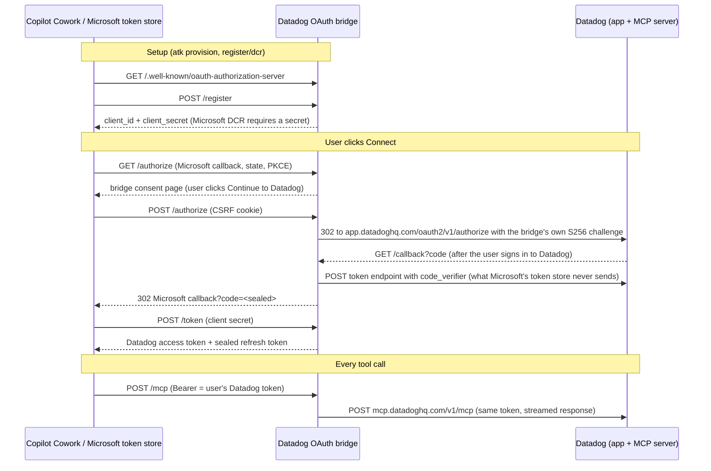

# Datadog OAuth bridge for Copilot Cowork

The Datadog VS Code extension signs users in by running OAuth in its own code: it opens Datadog's
sign-in with a PKCE S256 challenge, keeps the verifier, and sends `code_verifier` to Datadog's token
endpoint. A Cowork plugin is declarative (manifest, skills, tool list) and cannot run code, and
Microsoft's token store cannot complete Datadog's OAuth on its own (see [../RELEASES.md](../RELEASES.md),
1.4.1-1.4.5). This service runs the extension's sign-in on the server and puts a standard MCP
authorization server in front of Datadog's MCP server, so the plugin works on its own without VS Code.

It is an independent implementation of the same public OAuth flow; it does not contain Datadog code.

## How a Cowork user connects



## Endpoints

| Endpoint | Purpose |
| --- | --- |
| `GET /.well-known/oauth-protected-resource[/mcp]` | RFC 9728 metadata: resource `<base>/mcp`, authorization server `<base>` |
| `GET /.well-known/oauth-authorization-server` | RFC 8414 metadata (also `/.well-known/openid-configuration`) |
| `POST /register` | RFC 7591 registration. Issues `client_secret` (HMAC-derived, stateless). Redirect URIs must be on the allowlist |
| `GET /authorize` | Validates client, redirect URI (never redirects to an unvalidated URI), S256 PKCE and state, then shows the bridge's consent page |
| `POST /authorize` | Consent confirmed (CSRF cookie checked): sends the browser to Datadog sign-in with the bridge's PKCE pair and a browser-binding cookie |
| `GET /callback` | Requires the browser-binding cookie, exchanges Datadog's code with `code_verifier`, then returns a sealed code to the Microsoft callback |
| `POST /token` | `authorization_code` (single use, `redirect_uri` bound) and `refresh_token` (client secret required); one of `client_secret_post` or `client_secret_basic` |
| `POST/GET/DELETE /mcp` | 401 with `WWW-Authenticate: Bearer resource_metadata=...` when unauthenticated; otherwise streams to Datadog's MCP server with the caller's token |
| `GET /healthz` | Liveness |

## Configuration

| Variable | Default | Notes |
| --- | --- | --- |
| `PUBLIC_BASE_URL` | required | Public HTTPS origin of the bridge (no path) |
| `BRIDGE_SECRET` | required | 32+ random bytes, base64/base64url. Seals codes and refresh tokens and derives client secrets. Rotating it signs every user out |
| `DD_SITE` | `datadoghq.com` | `us3.datadoghq.com`, `us5.datadoghq.com`, `datadoghq.eu`, `ap1.datadoghq.com`, ... |
| `UPSTREAM_SCOPE` | `mcp_read` | Datadog scope requested at sign-in. `mcp_read mcp_write` for write tools |
| `UPSTREAM_CLIENT_ID` | registered at startup | Datadog public client; by default registered through Datadog's DCR endpoint with `<base>/callback` |
| `UPSTREAM_MCP_URL` | `https://mcp.<site>/v1/mcp` | May carry a fixed query (for example `?omit_tools=...`); caller query parameters are merged on top |
| `ALLOWED_REDIRECT_URIS` | Microsoft's `oAuthRedirect` | Comma-separated exact URIs |
| `REQUIRE_DOWNSTREAM_PKCE` | `false` | `true` rejects token requests without `code_verifier` even from secret-authenticated clients |
| `PORT`, `LOG_LEVEL` | `8080`, `info` | |

## Security model

- **No token store.** Sign-in state, authorization codes and refresh tokens are AES-256-GCM envelopes
  whose purpose is bound as authenticated data, so a state cannot be replayed as a code. Keys come from
  `BRIDGE_SECRET` through HKDF-SHA256 with separate labels for sealing, client IDs and client secrets.
- **Users act as themselves.** Each user signs in to Datadog; the access token Microsoft stores is that
  user's Datadog token, and Datadog enforces the user's role and the `mcp_read`/`mcp_write` scopes.
- **Consent and browser binding.** Every client shares one Datadog client, so the bridge asks the user to
  confirm each connection on its own page (CSRF-protected POST), and the Datadog callback is accepted
  only in the browser that confirmed it. A link crafted by someone else cannot complete silently in a
  victim's browser even when the victim has a live Datadog session (MCP security best practices,
  "Confused deputy").
- **Redirects.** Only allowlisted redirect URIs are ever used; a bad client or redirect URI gets an
  error page, not a redirect.
- **PKCE.** The bridge always uses PKCE S256 with Datadog, and accepts only S256 from clients. A sent
  `code_verifier` must match; Microsoft's token store omits it, so a client that authenticates with its
  secret is accepted without it (logged as `token_pkce_verifier_omitted_by_confidential_client`). This is
  the RFC 9700 downgrade case, accepted for Microsoft and closed by `REQUIRE_DOWNSTREAM_PKCE=true`.
  Clients without a secret must send a valid verifier and cannot refresh.
- **Limits.** `/mcp` checks for a bearer token before reading any body (1 MB cap); request receive
  timeout 60 s; 1000 connections; OAuth bodies 64 KB; state 8 KB.
- **Codes** live 5 minutes and are single use (in memory, which is why the deployment runs one replica).
  Sealed refresh tokens expire after 90 days and carry the Datadog client they were issued for.
- **Logs** hold event names, client IDs, paths and status codes; never tokens, codes or secrets.

## Deploy (Azure Container Apps)

```powershell
./deploy/Deploy-Bridge.ps1 -SubscriptionId <sub> -ResourceGroup <rg> -ContainerAppsEnvironment <cae> `
  -AcrName <acr> -RegistryIdentity <user-assigned identity resource id with AcrPull>
```

The first run generates `BRIDGE_SECRET` in memory and stores it only as a Container Apps secret; later
runs roll the image and keep the secret. Any HTTPS host works: `docker build -t datadog-cowork-bridge .`
and run with the variables above.

## Connect the Cowork plugin

1. Deploy the bridge and note its base URL.
2. Microsoft token-store registration (DCR): in `../register/dcr`, copy `env/.env.dev.example` to
   `env/.env.dev`, set `DATADOG_BRIDGE_URL`, then `atk provision --env dev`. Microsoft's token service
   reads the bridge metadata and registers its client at `/register`. The run writes
   `DATADOG_DCR_CONFIGURATION_ID`.
3. Build the package:
   `python build.py --site us1 --profile readonly --bridge <base url> --auth dcr --reference-id <DATADOG_DCR_CONFIGURATION_ID> --output dist/<name>.zip`
4. Install: `atk install --file-path dist/<name>.zip --scope Personal` (or Cowork, **Add plugin**, choose
   the file).
5. In Cowork, open the Datadog plugin, **Connect**, sign in to Datadog, then ask Cowork to run
   `search_datadog_monitors`.

## Tests

`node --test test/*.test.mjs` starts a mock Datadog (authorization server and MCP server) and covers
metadata, registration, redirect validation, the full Microsoft flow with and without `code_verifier`,
Basic and post client authentication, tampering, replay, refresh, strict mode, the 401 challenge, JSON
and SSE proxying, body limits and log hygiene.

## Limitations

- One replica: code replay protection is in memory. Scaling out needs a shared store for used code IDs.
- Datadog access tokens pass through unchanged; revoking access is done in Datadog
  (Personal Settings, Applications) or by rotating `BRIDGE_SECRET`, which invalidates every refresh token.
